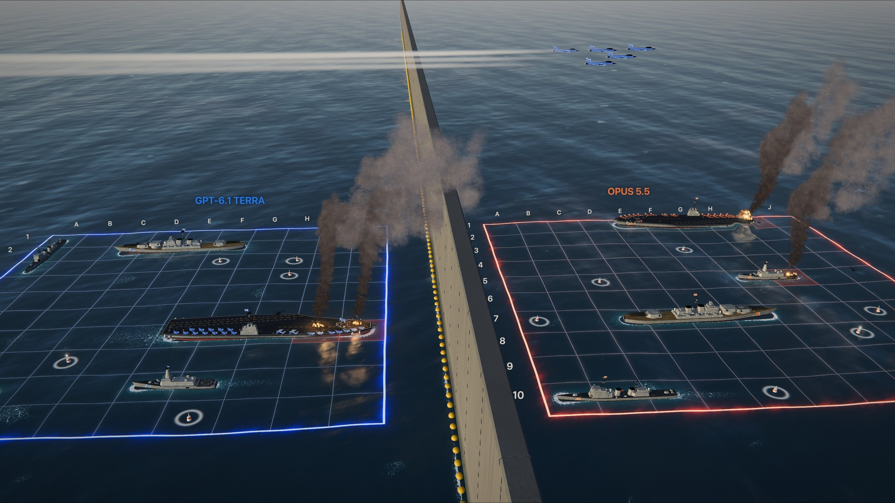

# Overview

AI Battleship: two AI models deploy their fleets and trade fire on a full-screen, real-time 3D ocean. You watch it like a video game. The scoreboard shows the two models by name (for example *GPT-6.1 Terra* vs *Opus 5.5*), and each fleet's status and its model's latest reasoning float on the water under its board.



## What you see

- **An open ocean** with Gerstner swells, a physically based sky with clouds, mirror reflections and sun glitter. Four layers of wind chop each move at the true phase speed of their wavelength, so short wavelets lag behind long ones. The sky, sunlit paint and their reflections in the water are balanced to realistic contrast.
- **Live water over the battle area**, using the same deep-water ripple method (iWave) as the sea reference. Every shell splash, blast, droplet that falls back, piece of debris and moving hull pushes the water. The push spreads as rings with real dispersion: long ripples outrun short ones, rings interfere, they reflect off hulls and the barrier, and they soak away at the edges. Ships sailing in drag real wakes behind them. The rings spread about 3.5 times faster than true speed at this scale so they still read from far above.
- **Whitewater as lace**: strikes leave a torn white boil that collapses into a bubble-net lace and slowly fades. A little foam traces thin veins; thick foam fills the cells, with blue creases between lit clumps. Hulls and the barrier carry the same lace along their waterlines.
- **Spray with real drag**: each droplet has a terminal speed set by its size, so fine spray hangs as mist while heavy water falls almost straight. Droplets are drawn as motion-blurred streaks. Where they land they press rings into the water, fleck it white, and a hard landing throws a smaller droplet back up out of its crown.
- **A concrete barrier** between the two fleets, so neither side can see the other's ships. It is a long precast wall running to the horizon, with a boom of yellow floats along its waterline. Every round arcs over it.
- **Two 10 × 10 grids projected onto the water like neon light**: a thin bright border with a halo that catches the waves, drawn smoothly at any distance.
- **Real scale**: every grid square is 75 m of sea, and each ship is built at the real length and beam of its class. The swell has real wavelengths, heights and speeds for that scale.
- **The classic fleet, at the classic sizes** (5, 4, 3, 3 and 2 squares), each modeled in detail after a real class:
  - **Carrier (5)**: a Gerald R. Ford-class carrier (337 m), the size of USS Gerald R. Ford or Abraham Lincoln. It has an angled flight deck with a deck park of Super Hornets, Hawkeyes, Seahawks and tractors. The island carries flat radar faces, deck-edge antennas, sponson CIWS and missile launchers, and hangar openings under the overhang.
  - **Battleship (4)**: an Iowa-class battleship (270 m) with three triple 16-inch turrets on a teak deck, a stepped tower bridge with wings, twin 5-inch mounts, Tomahawk box launchers, Harpoons, CIWS, boats and cranes.
  - **Cruiser (3)**: a Ticonderoga-class cruiser (173 m). The four SPY-1 faces sit on the cut-off corners of its deckhouses. It also has lattice masts, two Mk 41 launchers, two 5-inch guns, Harpoons and torpedo tubes.
  - **Submarine (3)**: an Ohio-class submarine (171 m) with its raised missile deck and 24 hatches, a sail with planes and masts, and limber holes.
  - **Destroyer (2)**: the little boat, a Freedom-class littoral combat ship (118 m). It has a faceted deckhouse, an enclosed mast, a 57 mm gun, Naval Strike Missiles, RAM, a big flight deck and four waterjets.
- **Detail on every ship**: windows, portholes, railings, bollards, anchor chains, vents, life-raft racks, searchlights, antennas, rotating radars, waving flags and crew on deck (the carrier's in their flight-deck jerseys). Hulls show their steel plating, each plate a slightly different shade, with rust weeping from seams and fittings and paint worn back at the edges.
- **Ships under way**: each ship steams slowly ahead and astern on her own squares, rides the swell, and pushes real waves and a wake into the live water.
- **Weapons that fit the ship**:
  - The battleship trains a turret and fires a three-gun broadside that heels the ship. It throws a fireball, a cloud of cordite smoke and a blast ring on the water, and the shells leave tracer streaks.
  - Cruisers ripple two missiles and the littoral combat ship fires one. Fire blows out of the launcher, and a dense smoke column climbs after the missile. The motor shows shock diamonds and lays a continuous, drifting smoke trail.
  - The submarine's missile breaches the surface.
  - The carrier strike: a Super Hornet (with its strakes, intakes, drop tanks, wingtip Sidewinders and twin nozzles) spools up to full afterburner on the bow catapult behind its raised blast deflector, steam leaking from the track. The catapult throws it off the bow. It climbs over the barrier with twin afterburner plumes and shock diamonds, vapor flashing over its wings in hard pulls. Having seen the enemy fleet, it doesn't come back: the pilot pushes over, accelerating in the dive, and flies the jet into the target cell with its Mk 84 still on the centreline, into the ship there or into the sea.
- **Impacts**:
  - **Miss**: the splash is worked out from the round that made it. Each weapon fires a real round with its own mass, explosive charge and fuze: a 1,225 kg 16-inch armour-piercing shell, a 5-inch or 57 mm high-explosive shell, an anti-ship missile, or the strike jet itself (about 19 t, with its Mk 84 and about 3 t of fuel aboard). Its speed and angle at impact come from its actual flight, capped at what the real round can reach. The crater grows with the energy put into the water (motion plus the share of the blast the water takes) to the ¼ power. That sets how tall the column stands (about 7 crater radii for a burst under the surface, 4.5 on it), how wide it is and how big the crown is. A round that comes in at a slant throws its crown and a fan of spray downrange, and its column leans the way it was travelling. Delay-fuzed armour-piercing shells punch in, a white dome lifts, then the plume bursts through. A missile's warhead bursts on the surface with a fireball and black smoke. A small shell flashes over a sharp spout and leaves a dark puff. A crashing jet's fuel rolls up in a second fireball, burns on the water downrange of the splash and throws wreckage. The water falls back as heavy rain, mist rolls out, rings spread and a marker buoy stays behind. The sea surface no longer rises and falls with the rings, which made it flex like a stretched sheet; they show in its shading and foam instead.
  - **Hit**: the incoming round's charge, mass, capped speed and direction control the burst. The radius grows with the cube root of coupled energy; a 57 mm round stays much smaller than a missile warhead. Sparks fly off the plating on contact, then a white-hot flash lasting hundredths of a second. The fireball is not one ball but a cluster of unequal lobes, thrown up and downrange by the round's momentum. Their edges fold into cauliflower billows, and each draws out taller as it rises. Brown-black soot lit from inside by the burning core takes over as they cool, then thins out into the smoke column instead of hanging as a solid ball. Jets of burning gas burst out of the hull and are stopped by the air within metres. Delayed armour-piercing shells burst after contact and vent upward. The carrier jet strikes with its bomb and remaining fuel aboard, producing a larger burst and a second rolling fuel fireball. Wreckage is torn plates of hull, some still in grey paint and some charred black, mostly small with a few larger pieces. Fragments carry some of the incoming momentum, tumble, slow under drag and fall under gravity; heavier pieces travel differently from small shards. Torn steel is left standing at every hit: plates ripped up and bent outward around the hole, charred black, a few still glowing at the edge. It rides, lists and sinks with the ship. Burning fragments leave short trails and splash into the moving sea. Deck hits use a refractive pressure wave; waterline hits also displace water and throw spray. Fuel-rich hits burn longer, and secondary fires and cook-offs remain ship-dependent. This is a bounded visual approximation with accelerated battle time, not a fluid or structural-damage solver.
- **Fires after a hit**, modelled on real ship fires:
  - **More than one spot:** a hit sets more than one thing burning, so each fire has two or three burning spots spread along the deck. They all ride, list and sink with the ship.
  - **Growth:** fires start small, take hold over a few seconds and pulse like pool fires (about 1.5/√D times a second for a fire D metres across).
  - **Flames:** each spot has a low bed of flame and upright tongues that lick up to Heskestad's flame height (10–20 m for a fire this size), more of them on each pulse. The tongues lean with the wind and break off at the tips.
  - **Flare-ups:** every so often something new catches, flames leap up and a gout of black smoke follows. A fire that has burned a while spreads along the deck.
  - **Smoke:** it forms in the upper flames, so fire and plume are one column. It is oily and near-black where it leaves the flames, then billows up brown-grey, sunlit on top and dark underneath. It widens, curls in turbulent eddies and bends over in a wind that strengthens with height.
  - **Scorching:** steel is soot-black at the heart, with browned paint around it and soot streaked down the sides. It still glows in fine veins and cracks.
  - **Going out:** fires hiss out in steam when the water reaches them.
  - **Long battles:** when the particle pool runs full, every fire emits less rather than new effects failing to appear.
- **Missile smoke**: solid-rocket exhaust is dense white smoke. The launch column is thrown up out of the cell, stopped by the air within tens of metres, then rises on its own heat, billows and drifts downwind. Exhaust deflected off the deck rolls across it and over the sides. The trail is laid down continuously along the flight path, so it stays one unbroken rope that widens, curls and shears in the wind long after the missile has gone.
- **Damage**: every hit tears a real hole, ringed by bent, stripped plating. A shell at the waterline opens the side so you see into the hull; a deck hit leaves a crater. A hit near a radar blows the antenna off; a hit near a turret jams it with its barrels drooping. Water comes in through the holes, so the ship lists toward the damage and settles a little lower with every hit.
- **Sinking**: the ship is wracked by explosions, then settles halfway (by the bow, by the stern, or broken in two) and stays there burning for the rest of the battle. The wreck marks the sunk ship, so its squares on the grid lose their red.
- **Life in the air**: a Seahawk helicopter flies a lazy circuit round each fleet with its rotors turning, and now and then a pair of Super Hornets on patrol crosses high over the battle.
- **Light**: ambient occlusion darkens every corner and contact point (deckhouse to deck, turret to barbette, hull at the waterline). The sun's shadow map follows the camera, so shadows stay crisp close up. Smoke casts shadows. Hot air shimmers above fires, the shock front of a big blast bends the view as it races out, and fast camera moves blur slightly, like a real camera. Fireballs are true volumes, swelling and cooling from white-yellow to dull red as they roll up into smoke, and smoke fades softly where it meets the sea or a ship.
- **Time of day**: each battle is fought at its own hour (morning, midday, afternoon or golden hour), with the sun's colour, the sky's haze and the light on the water to match, and the sun moves on slowly as the battle goes.
- **A cinematic camera** that cuts between shots like an edited battle sequence:
  - a low establishing view of the ship as it trains on the target;
  - close beside the gun, launcher or catapult as it fires;
  - a camera above the barrier panning with the round as it climbs across (on longer flights);
  - a drone flying right beside the round as it comes down, slowing to slow motion just before it lands;
  - for the carrier strike: a low shot on deck by the jet as it spools up, a deck camera at the bow whipping round as the jet charges past, a chase camera behind the jet over the barrier, a camera riding down the dive with the target growing ahead, then, in slow motion, a camera beside the target as the jet comes in, holding on the blast;
  - a low angle over the water on the far side as it strikes.
  
  There is also a tactical wide view and a free camera. Scroll or pinch to zoom whichever camera is running, and drag at any time to take the camera yourself.
- **ElevenLabs v3 sound**: local stereo recordings for three distinct missile launches (cruiser, light ship and submarine), heavy and light naval guns, hull hits, ocean misses, sinking steel, jets, torpedoes and a looping open sea. Weapon events retain camera-relative distance, pan and arrival delay, with subtle per-shot pitch variation and bounded overlap. Synthesized audio covers loading failures and the remaining whistles, horns and UI cues. No ElevenLabs account or API call is needed during play. [Audio provenance](static/audio/elevenlabs-v3/PROVENANCE.md).

Everything is generated in code with [three.js](https://threejs.org) (vendored in `static/vendor/three`), so there are no model or texture downloads.

## The heads-up display

- **Scoreboard (top)**: each model's name, its mascot, ships afloat, the enemy ships it has sunk, and whether it is thinking.
- **Under each board**: one line of minimal ship icons (dimmed once a ship is sunk, a red dot when damaged) and the model's latest explanation, fixed on the water like the A–J and 1–10 labels. They fade out in close-ups and stay hidden behind the barrier.
- **Bottom**: the current attack or event, with Pause, New match and History.

Shots, hits, accuracy and thinking time are not shown during the match. They are saved with every API game and appear in the *History* table.

## Connections

Pick one under *Connection* on the setup screen, then pick a model for each fleet:

- **Test** (default): the chosen models are shown, but their moves are simulated: no LLM calls and no keys. The simulation uses a probability map of where ships can still fit.
- **API keys**: calls the OpenAI and Anthropic APIs with the keys in `.env`.

The model lists are in `MODELS` in `players.py`. Check the IDs against your provider's model list before connecting keys.

## Quickstart

Install the Python dependencies:
```bash
python3 -m venv .venv && source .venv/bin/activate && pip install -r requirements.txt
```

Run the app:
```bash
python app.py
```

Then open http://127.0.0.1:5001. For API mode, copy `.env.example` to `.env` and add your keys. Never commit a populated `.env` (it is in `.gitignore`). Finished API games are saved to `data/battle-history.json` and shown under *Universal stats* and *History*.

## Controls

| Input | Action |
| --- | --- |
| Drag | Orbit the camera (switches to the free camera from the current view) |
| Right-drag | Pan (free camera) |
| Scroll / pinch | Zoom in or out, in any camera mode |
| `1` `2` `3` | Cinematic, tactical or free camera |
| `H` | Hide or show the overlay |
| `M` | Sound on or off |
| `F` | Full screen |

The speed button in the top left plays the battle at 1×, 2× or 4×.
