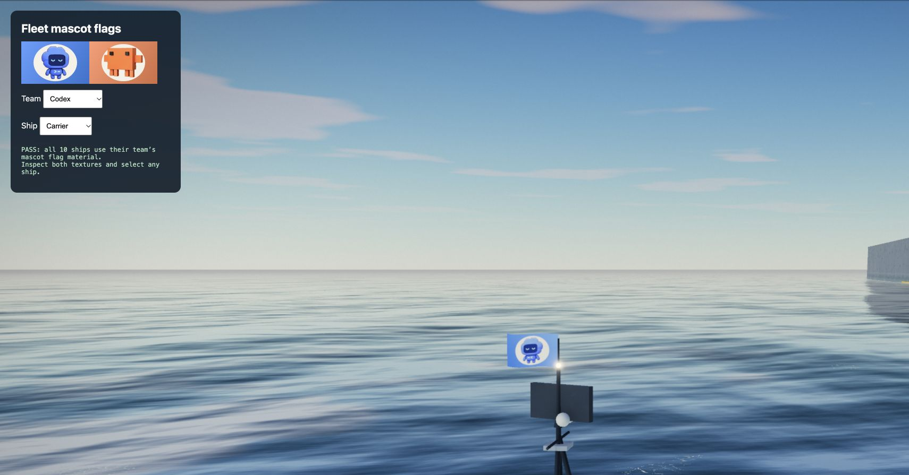
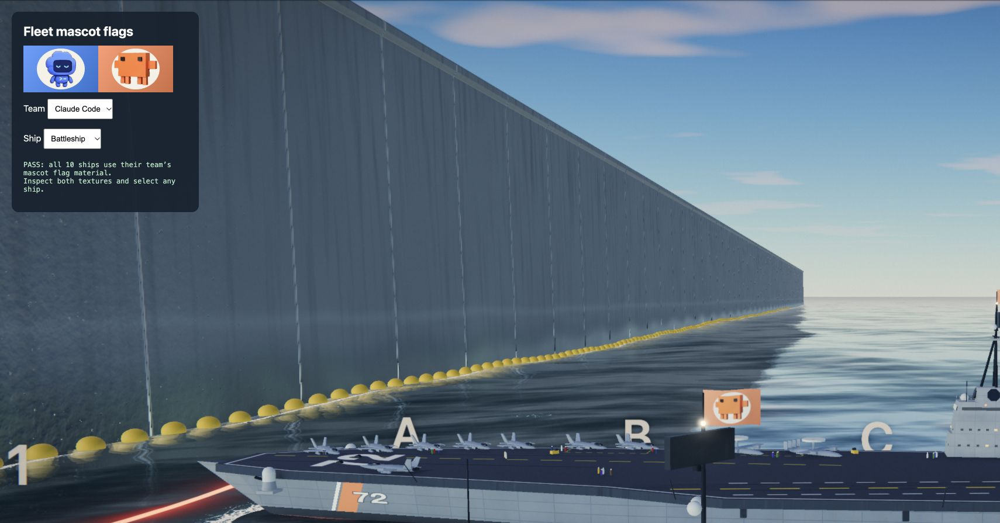

# Impact audio and mascot flags

Verified November 7, 2026 (November 8 UTC).

- `node --test tests/*.test.mjs`: 13 passed, including projectile routing, hull/caliber pitch, water filtering, missing-asset fallback, spatial playback, mute, voice limits and cleanup.
- Chrome, `tests/audio-browser.html`: all 15 WAV files decoded and contained audio; all event graphs played and released; mute blocked new events. The four new events are exercised through the explosion metadata path, including underwater filtering.
- Four generated impact WAVs: stereo 48 kHz PCM, 3/4/5/4 seconds, unique content, peak normalized to 0.85. Signal starts in the first 100 ms and decays to near silence. Existing missile impact recording retained.
- Chrome, `tests/flags-browser.html`: deployed all ten ships and checked that each uses its team's shared flag material. Visually inspected both texture previews and close views of the Codex carrier and Claude Code battleship. Mascot faces and original proportions are preserved.

Serve with `python3 -m http.server 5014 --bind 127.0.0.1`; open either review page above. The flag page allows selecting both teams and all five hulls. Audio review uses local recordings only. No model calls or live matches are needed.

Audio treatment is perceptual sound design, not measured hull acoustics. Existing silent radio/cockpit placeholders are outside the projectile-impact coverage added here. Sound generation provenance and exact prompts are in `static/audio/elevenlabs-v3/PROVENANCE.md`.
