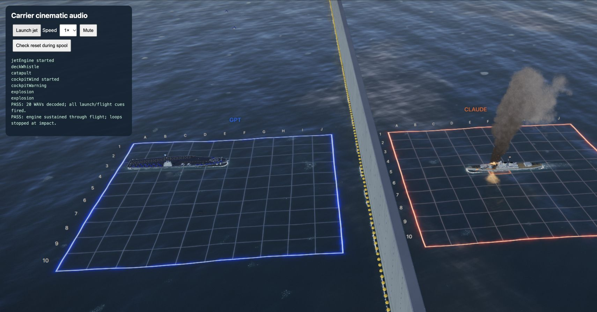
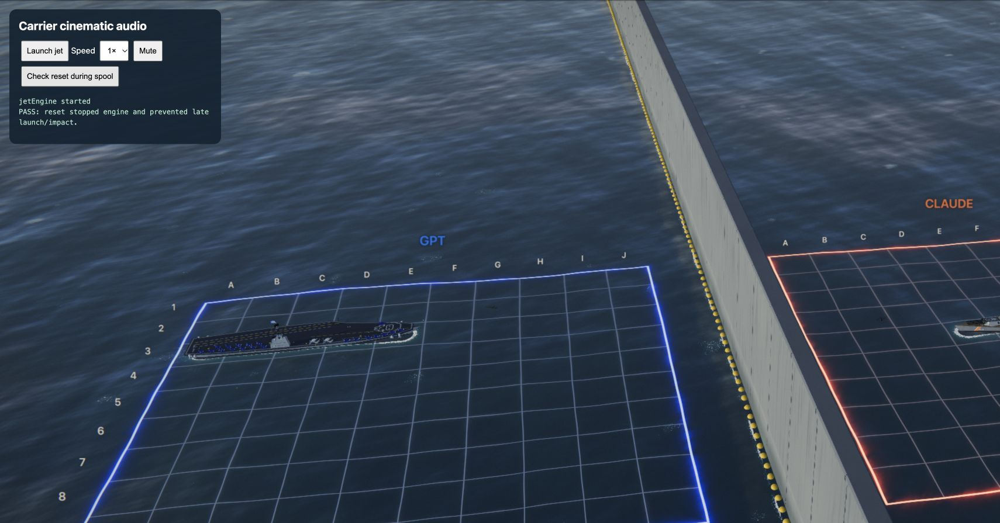
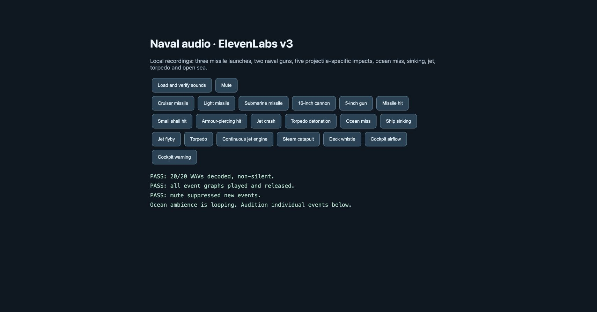

# Carrier cinematic soundtrack verification

Verified November 8, 2026 against main `a14af9e`.

The previous strike used a six-second flyby recording at a fixed point on the carrier. Its maximum playback duration was shorter than the slowed cinematic, and the deck/cockpit cue names had no sound assets. The strike now owns a moving engine loop for the entire animation and a separate cockpit wind loop for the interior view. Five new ElevenLabs v3 recordings cover engine, catapult, whistle, wind and warning.

- `node --test tests/*.test.mjs`: 15 passed. Covers loop lifetime past the sample duration, position/throttle/filter updates, natural pitch when pace changes, mute-compatible lifetime, fallback buffers, loop cap, idempotent stop and cleanup, plus existing impact tests.
- Chrome `tests/carrier-audio-browser.html`: complete cinematic at 1× and 4×; engine, whistle, catapult, cockpit airflow, warning and explosion cues fired. Engine remained active beyond eight seconds at 1× and all flight loops stopped at impact.
- Final 1× run also asserted that the one-shot cues actually started recorded voices and engine/wind started live loop voices, with audio unmuted. Passed with no browser errors.
- Reset during spool: stopped the engine and prevented cancelled launch/impact callbacks. The reset guard is needed because resetting resolves pending animation waits.
- Chrome `tests/audio-browser.html`: 20/20 WAVs decoded and contained signal; all playback graphs released; mute suppressed new one-shot events. Includes the new continuous engine and cockpit airflow audition buttons.
- New assets: stereo PCM, 48 kHz, peaks 0.85. Engine and airflow loops have 50 ms overlap joins; one-shot cues remain two seconds. Exact prompts, source filenames and credit usage are in the audio provenance document.

Reproduce with `python3 -m http.server 5016 --bind 127.0.0.1`, then open either test page. The carrier review runs local scenes only; it makes no model calls. Use **Launch jet**, the speed selector and **Check reset during spool**.

The optional carrier/pilot dialogue placeholders remain silent. This change adds aircraft, deck and cockpit effects, not spoken dialogue.
