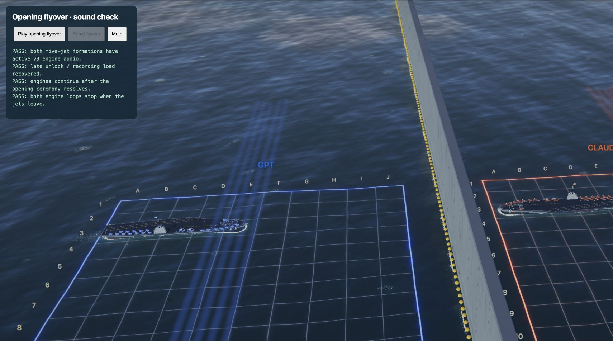
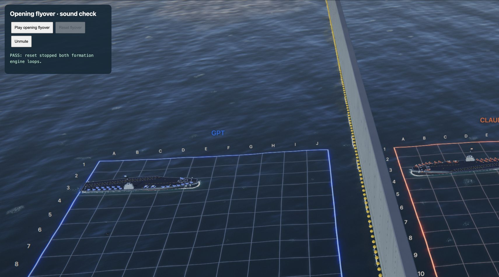

# Opening flyover audio verification

Verified November 8, 2026. Uses the existing `jet-engine-loop.wav` recording generated with ElevenLabs Sound Effects v3; no new generation or credit spend was needed.

The opening already requested an engine loop, but an audio context that was not yet unlocked produced a permanently inert handle, and a pending recording left the flight on its noise fallback. The opening's speed could also make the old Doppler denominator negative, incorrectly lowering pitch during approach.

Changes: recover audio when unlocked, replace fallback with the recording when available, bound radial speed before the Doppler division, fade the ends of each flight, give the ceremony modest additional presence, and retire patrols before launching the two opening formations. Each formation keeps one positional sound voice until departure; reset stops both.

- `node --test tests/*.test.mjs`: 25 passed. New regression checks cover continuous/finite approach pitch, late unlock, fallback upgrade exactly once, and no restart churn after a voice is stopped.
- Chrome, `tests/flyover-audio-browser.html`: both five-jet formations had active recorded voices after starting before audio unlock; recordings loaded successfully. Both engines remained active when the opening ceremony promise resolved and stopped once the jets left. No browser errors.
- Replayed, toggled mute, then reset: both loop handles stopped and the active loop set was empty.

Serve with `python3 -m http.server 5020 --bind 127.0.0.1`, then open the test page and press **Play opening flyover**. The preview uses no server-side match or model calls.

