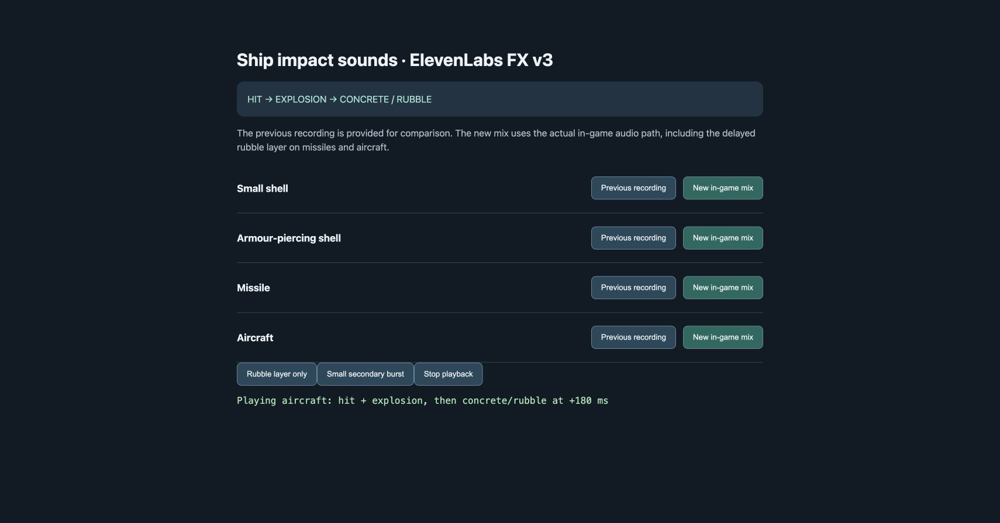
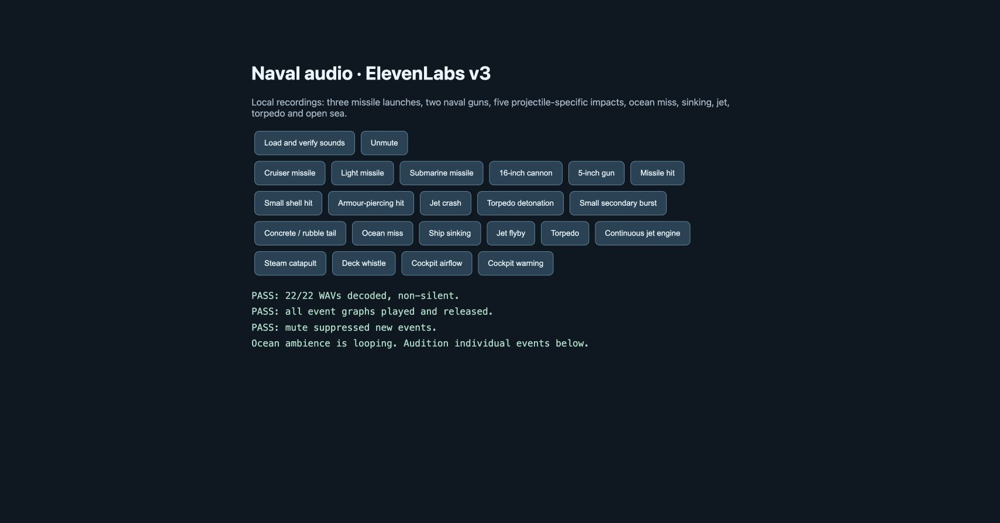
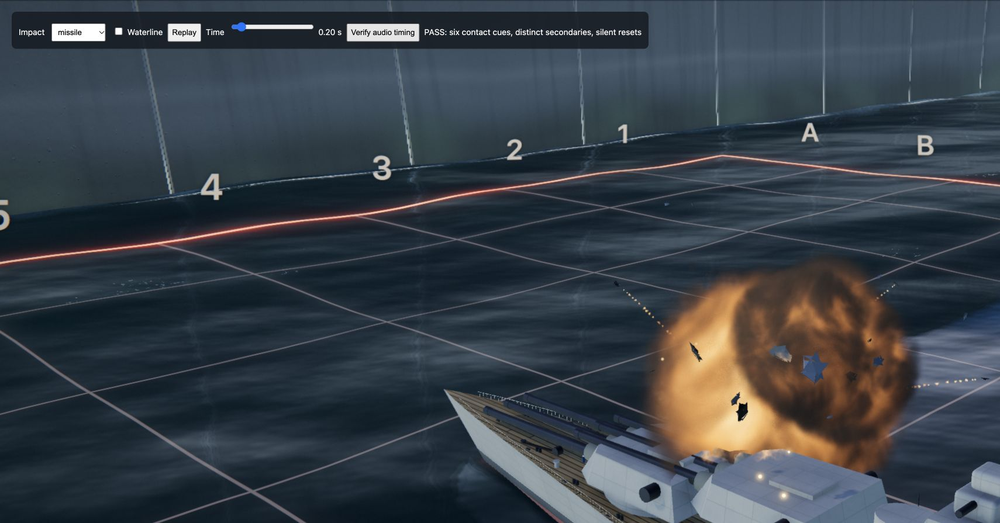

# Ship-impact sound rework

November 8, 2026. Six new ElevenLabs Sound Effects v3 assets replace the four above-water impact recordings and add separate concrete/rubble and small-secondary layers.

## Behavior

- Hull contact starts the sound immediately, including armour-piercing rounds whose visual detonation has a fuze delay.
- Missile, submarine-missile and aircraft hits add the requested dry concrete/rubble aftermath 180 ms after the primary sound.
- Small secondary bursts use their own quieter recording, rather than replaying the full missile explosion. Missing optional secondaries remain quiet.
- Primary impacts and rubble have no added synthetic reverb send. Smaller pitch shifts preserve their attack; gain is bounded, and waterline filtering retains more of the impact detail.
- Previous recordings remain available for direct comparison. The comparison labels distinguish the old raw recording from the new in-game mix.

## Verification

- `node --test tests/*.test.mjs`: 16 passed. Includes primary-before-rubble timing, independent secondary selection, absent-secondary behavior, dry sends, fast attack and voice cleanup, plus prior audio/physics tests.
- Chrome `tests/audio-browser.html`: 22/22 WAVs decoded and non-silent; all graphs played/released; mute blocked new events.
- Chrome `tests/impact-browser.html`, **Verify audio timing**: all six weapon families emitted one immediate contact cue; later explosions were tagged as secondaries; `sound:false` suppressed all delayed sounds.
- Chrome `tests/impact-audio-browser.html`: missile and aircraft playback paths started successfully, including the rubble layer, with no console errors. Comparison page kept available for listening review.
- New WAVs are stereo 48 kHz PCM, peak-normalized to 0.85. Leading quiet was removed from the missile and secondary assets; exact source files, prompts and trim durations are in `static/audio/elevenlabs-v3/PROVENANCE.md`.

These checks verify assets, timing and playback behavior; they are not a claim of perceptual listening approval. The comparison page lets the listener assess the intended hit → explosion → concrete/rubble sequence.

Serve locally with `python3 -m http.server 5018 --bind 127.0.0.1` and open the pages above. No live match, external audio service, credentials or model call is required during playback.

