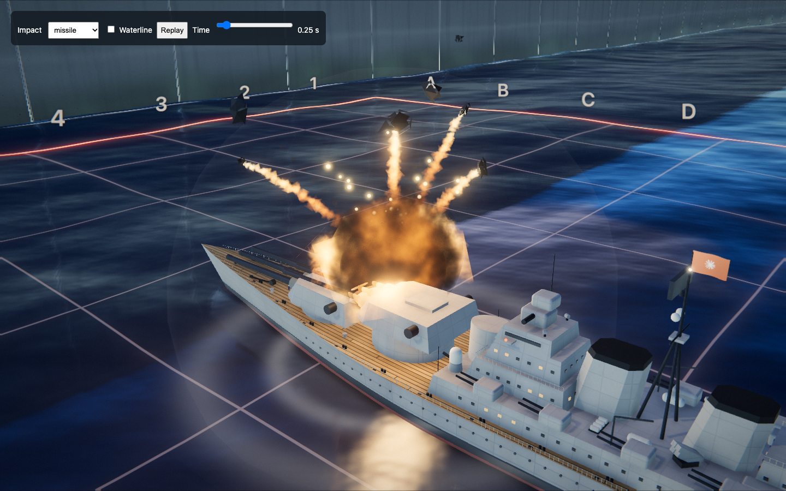
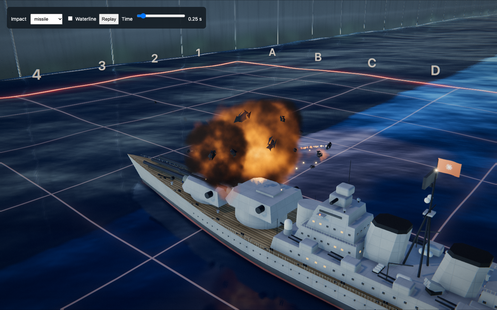

# Ship impact review

The same missile hit at 0.25 seconds on an Iowa-class battleship, with a fixed camera and initial particle seed:

| Main before this change | New impact |
| --- | --- |
|  |  |

The long bright flash and spherical pressure bubble give way to shorter illumination, irregular hot volumes, darker fragments and less prominent burning trails. The incoming projectile now supplies the round specification and arrival velocity to both primary and follow-up missile hits.

## Verification

- `node --test tests/*.test.mjs`: 11 passing tests, including energy/radius scaling, capped speed, momentum direction, gravity and matching debris trajectories at 30/60/144 Hz.
- Headless Chrome / WebGL: all six weapon recipes have finite particle positions, expire fully after 20 simulated seconds and reset without delayed respawning. Deck bursts do not create water rings; the torpedo case does.
- Complete gun, salvo, missile, submarine missile, carrier jet and torpedo hit sequences finish, deliver nonzero arrival velocities and leave the target cell burning. The carrier retains its 19,000 kg jet, 3,000 kg fuel and impact fuze. The light gun retains its 2.4 kg round; torpedoes retain their own impact profile. The cruiser exercises its second missile impact too.
- Zero browser JavaScript or shader errors in the final checks. No LLM/API calls.
- Inspected rendered frames at 0.08, 0.25, 0.7 and 1.8 seconds for missiles, plus shell and strike bursts. Fireball rendering stays within the existing six-volume pool and debris within 220 instances. This is a correctness/visual check, not a hardware performance benchmark.

## Reproduce

From the checkout, serve the files with `python3 -m http.server 5012 --bind 127.0.0.1`, then open `http://127.0.0.1:5012/tests/impact-browser.html`. Select a weapon, scrub time, toggle waterline or replay the burst. The fixture uses the real theater renderer and effects without a backend or credentials.

With Playwright available, run `node tests/impact-browser-check.cjs`. It uses installed Chrome. `PLAYWRIGHT_MODULE` can point to an existing Playwright installation; `IMPACT_REVIEW_URL` can select another local port. The checker exercises recipe cleanup and complete combat sequences.

## Scope and limits

The model combines explosive energy with a visual coupling fraction of kinetic energy, applies cube-root radius scaling, and transfers a bounded portion of incoming momentum into ejecta. Exact linear-drag integration makes fragment trajectories independent of frame subdivision. Gas cools, expands and rises with approximate buoyancy; the shader breaks up its edge and reveals hot pockets through soot.

Battle time and gravity are accelerated for readability. This is not CFD, structural penetration, or a rigid-body hull-collision solver: debris collides with the moving sea surface, not detailed deck geometry. Fuel and secondary cook-offs remain artistic, ship-specific presets. The existing miss recipes and carrier flight sequence are retained; the shared volume/debris renderer also improves their appearance.
